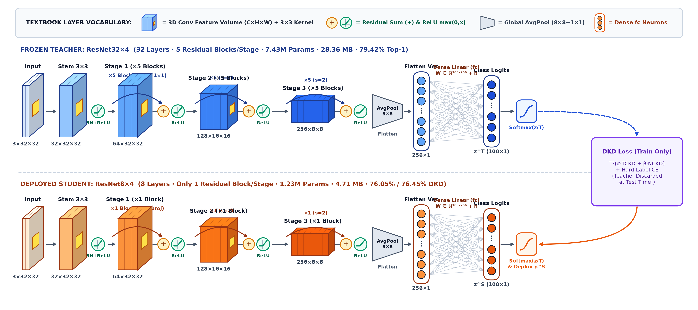

# From-Scratch DKD Implementation Progress (`notebooks/05_dkd_from_scratch.ipynb`)

Goal: Implement the entire CIFAR-100 Decoupled Knowledge Distillation (`ResNet32×4 -> ResNet8×4`) pipeline **linearly in a single notebook from scratch** (zero imports from `src/` or `scripts/`), one cell at a time, with numerical & visual sanity checks after every building block.

Companion cell-by-cell reasoning guide: see `NOTEBOOK_GUIDE.md` (keep updating it as we add new cells!).

---

## Completed Today

### Stage 1 — Environment, Raw CIFAR-100 Download & Byte Unpacking (Done)
- Set up reproducibility (`SEED = 42`), Apple Silicon `mps` / Colab `cuda` auto-detection, and `FAST_DEV_RUN = True`.
- Verified/downloaded official CIFAR-100 archive (`MD5` check) in `data/cifar-100-python/`.
- Unpickled raw Python-2 `train` (`50,000 × 3,072`), `test` (`10,000 × 3,072`), and `meta` (`100` fine + `20` coarse class names).
- Reshaped channel-major flat bytes `(-1, 3, 32, 32) -> .transpose(0, 2, 3, 1)` into `(N, 32, 32, 3)` RGB `uint8` arrays and visually verified 10 sample images.

### Stage 2 — Preprocessing, Augmentation & PyTorch `Dataset`/`DataLoader` (Done)
- Verified where `CIFAR100_MEAN = [0.5071, 0.4867, 0.4408]` and `CIFAR100_STD = [0.2675, 0.2565, 0.2761]` come from directly on `train_images / 255.0`.
- Implemented `preprocess_train` (4-pixel zero pad -> random `32×32` crop -> `50%` horizontal flip -> normalize -> `CHW`), `preprocess_eval`, and `unnormalize_for_plot` across separate cells; visually verified 5 views of image `0` (`cattle`).
- Implemented custom `SimpleCIFAR100(Dataset)` and verified `train_loader` (`782` batches of `[64, 3, 32, 32]`) and `test_loader` (`[64, 3, 32, 32]` — note: `test_loader` currently uses `batch_size=BATCH_SIZE` = `64`, which works identically for accuracy).

### Stage 3 — Pretrained Teacher Checkpoint Inspection, ResNet From Scratch & 2D Boundary (Done)
- Located `checkpoints/cifar_teachers/resnet32x4_vanilla/ckpt_epoch_240.pth`.
- Loaded and inspected top-level keys (`['epoch', 'model', 'accuracy', 'optimizer']`) and the `172` parameter tensors inside `raw_ckpt['model']` (`conv1`, `bn1`, `layer1..layer3`, `fc`).
- Implemented and shape-verified `BasicBlock(nn.Module)` in Cell 20 (both identity shortcut `(2, 64, 32, 32) -> (2, 64, 32, 32)` and projection downsample `(2, 64, 32, 32) -> (2, 128, 16, 16)`).
- Implemented `make_shortcut` + explicit `StudentResNet8x4` (`1,233,540` params) and `TeacherResNet32x4` (`7,433,860` params — `6.03x` larger than Student).
- Loaded Megvii's 172 pretrained Teacher tensors with `strict=True` (`<All keys matched successfully>`), froze the Teacher (`eval()` + `requires_grad_(False)`), verified `evaluate_model(teacher, test_loader)` (~79.42% test top-1), and plotted the Teacher's 256-D PCA 2D feature space & linear decision boundaries across 4 training classes (`apple`, `cattle`, `bus`, `dolphin`).

### Stage 4 — Classical KD, TCKD, NCKD, DKD & All 5 Experiment Modes (Done)
- Implemented classical `kd_loss(logits_s, logits_t, T=4.0)` and visualized `T = 1.0` vs. `T = 4.0` softmax ("dark knowledge" emerging on visually related classes).
- Verified untrained Student baseline `CE` on a 64-image batch (`4.6145` vs. theoretical random guessing $\ln(100) = 4.6052$) alongside `kd_loss = 10.6828`, and plotted side-by-side `CE` one-hot vs. `KD` soft-target bar charts on Image `0` (`crocodile -> lizard, leopard, dinosaur, tank, sea`).
- Implemented `tckd_per_sample`, `nckd_per_sample` (using conditional probability renormalization via `-1000.0` logit masking before softmax/log_softmax), and `dkd_loss` across separate cells.
- Numerically & visually proved Equation (1) (`TCKD + (1 - p_t^T)*NCKD == KD = 10.6828`), showing how classical KD crushed `NCKD` to `1.3759` while `TCKD` took `9.3069`.
- Implemented `compute_student_loss(...)` covering all **5 semester-project modes** (`ce`, `kd`, `tckd_only`, `nckd_only`, `dkd` with fixed published recipe `alpha=1.0, beta=8.0, T=4.0` and 20-epoch linear warmup) and plotted the 5-mode stacked comparison + 20-epoch warmup ramp.

---

## Architectural Deep Dive — CIFAR ResNet (`ResNet32×4` & `ResNet8×4`)

### 1. Input Tensor Dimensions
A single preprocessed CIFAR-100 image is a 3D channel-first tensor \((C, H, W) = (3, 32, 32)\). When `DataLoader` batches \(B = 64\) images together, the network receives a 4D tensor:

$$
\mathbf{X}_{\text{in}} \in \mathbb{R}^{B \times C \times H \times W} = \mathbb{R}^{64 \times 3 \times 32 \times 32}
$$

Immediately after the initial \(3 \times 3\) stem convolution maps the \(3\) RGB channels to \(32\) feature maps, each image becomes \((32, 32, 32)\)—giving a batch tensor of shape \((64, 32, 32, 32)\) entering `layer1.0`.

---

### 2. Convolution (`nn.Conv2d`) Properties & Spatial Output Formula
Every 2D convolution transforms spatial dimensions \((H_{\text{in}}, W_{\text{in}}) \to (H_{\text{out}}, W_{\text{out}})\) according to:

$$
H_{\text{out}} = \left\lfloor \frac{H_{\text{in}} + 2p - k}{s} \right\rfloor + 1, \qquad W_{\text{out}} = \left\lfloor \frac{W_{\text{in}} + 2p - k}{s} \right\rfloor + 1
$$

where \(k\) is `kernel_size`, \(p\) is zero `padding`, and \(s\) is `stride`.

Across the entire network, **every `nn.Conv2d` sets `bias=False`** because `nn.BatchNorm2d` immediately follows every convolution, subtracts the per-channel mean (which cancels any additive conv bias), and applies its own learnable shift parameter \(\beta\):

$$
\text{BN}(u) = \gamma \cdot \frac{u - \mu_B}{\sqrt{\sigma_B^2 + \epsilon}} + \beta
$$

We use only **three** convolution configurations across `CifarResNet`:

| Convolution Role | Kernel \(k\) | Padding \(p\) | Stride \(s\) | Spatial Formula Example (\(H_{\text{in}} = 32\)) | Purpose |
| :--- | :---: | :---: | :---: | :---: | :--- |
| **Standard Feature Conv** | \(3 \times 3\) | \(1\) | \(1\) | \(\lfloor \frac{32 + 2(1) - 3}{1} \rfloor + 1 = 32\) *(unchanged)* | Extracts local \(3 \times 3\) spatial patterns |
| **Strided Downsampling Conv** (`conv1` of `layer2.0`, `layer3.0`) | \(3 \times 3\) | \(1\) | \(2\) | \(\lfloor \frac{32 + 2(1) - 3}{2} \rfloor + 1 = 16\) *(halved)* | Halves \((H, W)\) cleanly without `MaxPool2d` |
| **Shortcut Projection Conv** (`downsample[0]`) | \(1 \times 1\) | \(0\) | \(1\) or \(2\) | \(\lfloor \frac{32 + 0 - 1}{s} \rfloor + 1 \in \{32, 16\}\) | Linearly projects channels (and subsamples if \(s=2\)) so \(\text{shortcut}(\mathbf{x})\) matches \(\mathcal{F}(\mathbf{x})\) |

---

### 3. Exact Tensor Trace: Stem to First Residual Block (`layer1.0`)

#### Step A — The Stem (`conv1 + bn1 + relu`, **no** skip connection)
- **Tensor IN:** \(\mathbf{X}_{\text{in}} \in \mathbb{R}^{64 \times 3 \times 32 \times 32}\)
- **Weight Tensor:** \(\mathbf{W}_{\text{conv1}} \in \mathbb{R}^{32 \times 3 \times 3 \times 3}\) (`3 -> 32` channels, `stride=1`, `padding=1`, `bias=False`)
- **Tensor OUT (entering `layer1.0`):** \(\mathbf{X}_{\text{stem}} \in \mathbb{R}^{64 \times 32 \times 32 \times 32}\)

$$
\mathbf{X}_{\text{stem}} = \text{ReLU}\big(\text{BN}_1(\text{Conv}_{3 \times 3,\, 3 \to 32,\, s=1,\, p=1}(\mathbf{X}_{\text{in}}))\big) \in \mathbb{R}^{64 \times 32 \times 32 \times 32}
$$

#### Step B — Inside the First Residual Block (`layer1.0`)
Incoming stem tensor \(\mathbf{x} \in \mathbb{R}^{64 \times 32 \times 32 \times 32}\) splits into **two parallel branches**:

1. **Main Residual Branch** \(\mathcal{F}(\mathbf{x})\) — two \(3 \times 3\) convolutions (`32 -> 64`, then `64 -> 64`):

$$
\mathbf{h}_1 = \text{ReLU}\big(\text{BN}_1(\text{Conv}_{3 \times 3,\, 32 \to 64,\, s=1,\, p=1}(\mathbf{x}))\big) \in \mathbb{R}^{64 \times 64 \times 32 \times 32}
$$

$$
\mathcal{F}(\mathbf{x}) = \text{BN}_2\big(\text{Conv}_{3 \times 3,\, 64 \to 64,\, s=1,\, p=1}(\mathbf{h}_1)\big) \in \mathbb{R}^{64 \times 64 \times 32 \times 32}
$$

2. **Shortcut Branch** \(\mathcal{G}(\mathbf{x})\) (`self.downsample`) — because \(\mathbf{x}\) has \(32\) channels while \(\mathcal{F}(\mathbf{x})\) has \(64\) channels, direct addition \(\mathcal{F}(\mathbf{x}) + \mathbf{x}\) would fail, so `layer1.0` projects \(\mathbf{x}\) with a \(1 \times 1\) stride-\(1\) convolution:

$$
\mathcal{G}(\mathbf{x}) = \text{BN}_{\text{ds}}\big(\text{Conv}_{1 \times 1,\, 32 \to 64,\, s=1,\, p=0}(\mathbf{x})\big) \in \mathbb{R}^{64 \times 64 \times 32 \times 32}
$$

3. **Element-Wise Addition & Post-Activation** (producing output tensor \(\mathbb{R}^{64 \times 64 \times 32 \times 32}\)):

$$
\mathbf{y} = \text{ReLU}\big(\mathcal{F}(\mathbf{x}) + \mathcal{G}(\mathbf{x})\big) \in \mathbb{R}^{64 \times 64 \times 32 \times 32}
$$

---

### 4. How `BasicBlock` Resolves All Shape Mismatches Across the Network

In general, every `BasicBlock` computes:

$$
\mathbf{y} = \text{ReLU}\big(\mathcal{F}(\mathbf{x}; \{\mathbf{W}_i\}) + \text{shortcut}(\mathbf{x})\big), \qquad \text{shortcut}(\mathbf{x}) = \begin{cases} \mathbf{x}, & \text{if } C_{\text{in}} = C_{\text{out}} \text{ and } s = 1 \\ \text{BN}(\mathbf{W}_s *_{1\times 1,\, s} \mathbf{x}), & \text{if } C_{\text{in}} \neq C_{\text{out}} \text{ or } s \neq 1 \end{cases}
$$

Across all 3 stages (`layer1`, `layer2`, `layer3`), this creates **three exact cases** (He et al., 2016 *Option B / Projection Shortcut*):

1. **Case 1 — Pure Identity** (`downsample = None`):
   - **Condition:** \(C_{\text{in}} = C_{\text{out}}\) and \(s = 1\).
   - **Where it occurs:** Blocks `1..4` of every stage in the Teacher (`layer1.1..4`, `layer2.1..4`, `layer3.1..4`).
   - **Mechanism:** \(\text{shortcut}(\mathbf{x}) = \mathbf{x}\) with **zero** extra parameters, forming an unbroken gradient highway (\(\frac{\partial \mathbf{y}}{\partial \mathbf{x}}\) contains \(+I\)).
2. **Case 2 — Channel-Only Projection** (\(1 \times 1\) conv, \(s = 1\)):
   - **Condition:** \(C_{\text{in}} \neq C_{\text{out}}\) (\(32 \to 64\)) while spatial size stays \(32 \times 32\) (\(s = 1\)).
   - **Where it occurs:** **Only `layer1.0`**.
   - **Mechanism:** \(1 \times 1\) stride-\(1\) conv + BN linearly mixes the \(32\) channels at each pixel into \(64\) channels.
3. **Case 3 — Channel + Spatial Projection** (\(1 \times 1\) conv, \(s = 2\)):
   - **Condition:** \(C_{\text{in}} \neq C_{\text{out}}\) and \(s = 2\).
   - **Where it occurs:** **`layer2.0`** (\((64, 32, 32) \to (128, 16, 16)\)) and **`layer3.0`** (\((128, 16, 16) \to (256, 8, 8)\)).
   - **Mechanism:** Both `block.conv1` (\(3 \times 3\)) and `downsample[0]` (\(1 \times 1\)) use `stride=2`, simultaneously doubling channels and halving \((H, W)\).

---

### 5. Complete Stage-by-Stage Tensor Table (Teacher vs. Student)

Both architectures use the **exact same `CifarResNet` class** with channel widths `[32, 64, 128, 256]` and total learnable depth:

$$
\text{Depth} = 6n + 2 \quad \begin{cases} n = 5 \implies \text{Teacher } \texttt{ResNet32x4} \text{ (32 layers, } \approx 7.43\text{M params)} \\ n = 1 \implies \text{Student } \texttt{ResNet8x4} \text{ (8 layers, } \approx 1.23\text{M params)} \end{cases}
$$

| Stage | Tensor Going IN | Operations Inside Stage | Block `0` Shortcut | Blocks `1..n-1` Shortcut | Tensor Coming OUT |
| :--- | :--- | :--- | :--- | :--- | :--- |
| **Stem** (`conv1+bn1+relu`) | \((64, 3, 32, 32)\) | \(3 \times 3\) conv (\(3 \to 32\), \(s=1\), \(p=1\)) + BN + ReLU | *(No skip in stem)* | — | \((64, 32, 32, 32)\) |
| **`layer1`** (\(n\) blocks) | \((64, 32, 32, 32)\) | \(n \times \text{BasicBlock}\) (\(32 \to 64\), \(s=1\)) | \(1 \times 1\) conv, \(s=1\) (\(32 \to 64\)) | Identity (\(+\mathbf{x}\)) | \((64, 64, 32, 32)\) |
| **`layer2`** (\(n\) blocks) | \((64, 64, 32, 32)\) | \(n \times \text{BasicBlock}\) (\(64 \to 128\), \(s=2\)) | \(1 \times 1\) conv, \(s=2\) (\(64 \to 128\)) | Identity (\(+\mathbf{x}\)) | \((64, 128, 16, 16)\) |
| **`layer3`** (\(n\) blocks) | \((64, 128, 16, 16)\) | \(n \times \text{BasicBlock}\) (\(128 \to 256\), \(s=2\)) | \(1 \times 1\) conv, \(s=2\) (\(128 \to 256\)) | Identity (\(+\mathbf{x}\)) | \((64, 256, 8, 8)\) |
| **`avgpool`** (`AvgPool2d(8)`) | \((64, 256, 8, 8)\) | Spatial mean over each \(8 \times 8\) map + flatten | — | — | \((64, 256)\) |
| **`fc`** (`Linear(256, 100)`) | \((64, 256)\) | \(\mathbf{z} = \mathbf{h}\mathbf{W}^\top + \mathbf{b}\) (\(256 \to 100\)) | — | — | \(\mathbf{(64, 100)}\) *(logits)* |

> **Key Student vs. Teacher Insight:** Because the Student (`ResNet8×4`) has \(n = 1\) block per stage, every stage consists solely of Block `0`—so all 3 residual blocks in the Student use a \(1 \times 1\) `downsample` projection. In the Teacher (`ResNet32×4`, \(n = 5\)), Block `0` projects dimensions while Blocks `1, 2, 3, 4` in every stage act as pure parameter-free \(+\mathbf{x}\) identity highways.

---

### Stage 5 — Training Step, LR Schedule, Auto-Resume & Local Smoke Run (Done)
- Implemented `adjust_lr` (exact DKD schedule: `0.05` decayed by `0.1x` at epochs `[150, 180, 210]`) and `train_one_epoch` (Student gradient tracking vs. Teacher `torch.no_grad()`, synchronized GPU `ms/batch` stopwatch).
- Implemented `eval_student`, `run_experiment` (with fixed `SEED = 42` reset per run, `ckpt_last.pth` / `ckpt_best.pth` saving, `history.json` logging, and Colab disconnect auto-resume), and `plot_history`.
- Verified 3-epoch smoke run on Mac `mps` (`CE` dropping `4.51 -> 4.20`).

### Stage 6 — Computational Benchmark, 7-Run Experiment Suite & Colab L4 Launch (Done / Running on Colab L4!)
- Completed **Own Experiment #3 (Category F — Computational & Compression Analysis)** in Cell 45 (`ce: 53.65 ms/b`, `kd: 113.16 ms/b`, `dkd: 119.14 ms/b`; model size `28.4 MB -> 4.7 MB`, `6.03x` compression).
- Set up isolated Google Drive persistence (`MyDrive/DKD_Final_Training`) + 1-click `.zip` export across all **7 runs**:
  - **Reproduction (25%):** `dkd_T4`, `ce`, `kd_T4`
  - **Own Experiment #1 — Component Ablation (Cat. A):** `tckd_only_T4`, `nckd_only_T4`
  - **Own Experiment #2 — Temperature Sensitivity Sweep (Cat. B):** `dkd_T1` (`T=1.0`), `dkd_T4` (`T=4.0`), `dkd_T10` (`T=10.0`)
- Launched full 240-epoch training on **Google Colab NVIDIA L4 GPU** (`~18.6 ms/batch`, auto-resume already verified live across a runtime reconnect!).

### Stage 7 — Streamlit Web Deployment (`app.py` — Done Locally, Ready for Hugging Face Spaces!)
- Built standalone `app.py` (`Input -> 32x32 Resize & Eval Normalization -> Student ResNet8x4 + Reference Teacher ResNet32x4 -> Top-5 Confidence, Latency (ms), Interactive NCKD Dark-Knowledge Explorer & Experiment Leaderboard`).
- Verified live on `http://localhost:8501`, with automatic CIFAR-100 + Teacher checkpoint fetching built in for zero-friction **Hugging Face Spaces** cloud deployment.

---

## Key Scientific Insights & Catchy One-Liners (For Final Report, Slides & Viva)

1. **Why `+1.56%` (`74.49% -> 76.05%`) Is Huge — "Teacher-Gap Closure, Not Raw Percentage":**
   - On CIFAR-100, even the `6.03x` larger Teacher (`ResNet32×4`, `28.4 MB`) ceilings at **`79.42%`**, while the standalone `4.7 MB` Student (`ResNet8×4`) reaches **`72.89%`** — leaving a total recoverable Teacher–Student gap of only **`6.53%`**.
   - Classical KD (`74.49%`) closes **`24.5%`** of that gap (`+1.60%`); DKD (`76.05%`, or `76.25%` 2-run mean across `03` and `05`) closes **`48.4%–51.5%` — literally transferring `2x` as much of the Teacher's advantage** into the exact same tiny network.

2. **Zero-Cost Production Upgrade ("Loss Function, Not Architecture"):**
   - *"DKD is a training-time grading rubric, not an inference-time module."* Once Epoch 240 ends, the Teacher, Optimizer, and Loss Function are discarded: DKD ships **`0` extra parameters (`4.7 MB`), `0.00 ms` extra inference latency, and `< 2%` extra training time over KD** (`18.3 ms/batch -> 18.6 ms/batch` on NVIDIA L4, vs. `9.5 ms/batch` for plain `CE`).

3. **Signal vs. Seed Variance (`0.40%` vs. `+1.56%–2.72%`):**
   - Two independent `dkd_T4` runs (`76.45%` in `03` and `76.05%` in `05`, mean **`76.25%`**) sit within \(\pm 0.27\%\) (\(1\sigma\) single-seed noise on `10,000` test images) of Zhao et al.'s 5-trial mean (**`76.32%`**). In contrast, DKD's gain over Classical KD (`+1.56%` vs. our unit-weight `kd_T4`, `+2.72%` vs. Table 6 KD) is a **\(> 5\sigma\) algorithmic signal**.

4. **Overfitting Regularization Visible Directly in `tr_acc` vs. `te_acc` (Epoch 240):**
   - `ce` memorizes one-hot labels (`95.3%` train vs. `72.36%` test = **`22.9%` generalization gap**).
   - `kd_T4` shrinks the gap slightly (`93.5%` train vs. `74.10%` test), because as the Teacher's confidence \(p_t^T \to 1\), the coupled \((1 - p_t^T)\) factor mutes dark knowledge.
   - `dkd_T4` holds training accuracy at **`90.0%`** while lifting test accuracy to **`76.05%`** (**cutting the generalization gap to `14.0%`**) because \(\beta = 8.0\) forces the Student to keep fitting all 99 inter-class similarities rather than memorizing hard labels.

5. **The Smoking-Gun Ablation (`tckd_only_T4` Hurts Below Plain `CE`!):**
   - *"Listening to a confident Teacher's binary target score without its non-target dark knowledge is worse than having no Teacher at all."* Turning off `NCKD` (\(\alpha = 1, \beta = 0\)) drags accuracy ~`4%` **below** plain `CE`, proving empirically that Hinton's "dark knowledge" lives almost entirely inside the 99 non-target classes (`NCKD`).

6. **Why `dkd_T1` (`75.61%` at \(T = 1.0\)) Beats `kd_T4` (`74.49%` at \(T = 4.0\)):**
   - Classical KD needs high temperature (\(T = 4\)) primarily as a crutch to stop \((1 - p_t^T)\) from collapsing to zero. Once DKD decouples `NCKD` with an independent weight \(\beta = 8.0\), **even unsoftened \(T = 1.0\) logits (`75.61%`) outperform softened Classical KD (`74.49%`)**, while \(T = 4.0\) (`76.05%`) hits the sweet spot before \(T = 10.0\) over-flattens class rankings toward uniform noise.

7. **Controlled Experimental Hygiene (Paper Table 1 vs. Table 6):**
   - Keeping `1.0 * CE` fixed across all 5 modes (`ce`, `kd_T4`, `tckd_only_T4`, `nckd_only_T4`, `dkd_T4` — matching Paper Table 1's `73.63%` unit-weight KD setup rather than Table 6's `0.1 CE + 0.9 KD` `73.33%` setup) guarantees zero confounding from changing the `CE` weight by \(10\times\).

---

## Final Stretch Before Nov 23 Deadline
1. **Unzip Colab Results:** Once Colab finishes all 7 runs, download `dkd_final_training_results.zip` and extract into `outputs_final/` (`unzip dkd_final_training_results.zip -d outputs_final`).
2. **Deploy Public URL on Hugging Face Spaces (~5 mins):** Create a free Streamlit Space on `huggingface.co/spaces` and push `app.py`, `outputs_final/` (`ckpt_best.pth` + `history.json`), and Space `requirements.txt`.
3. **Final Report & README Update:** Compile the 12-section Final Research Report (extending `docs/mid_eval/mid_evaluation_report.tex` with Reproduction, 3 Own Experiments, and Deployment screenshots/URL) and update `README.md`.
