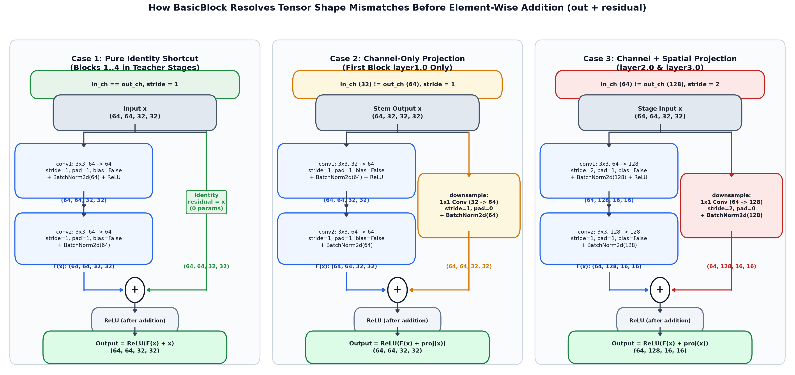

# From-Scratch DKD Implementation Progress (`notebooks/05_dkd_from_scratch.ipynb`)

Goal: Implement the entire CIFAR-100 Decoupled Knowledge Distillation (`ResNet32×4 -> ResNet8×4`) pipeline **linearly in a single notebook from scratch** (zero imports from `src/` or `scripts/`), one cell at a time, with numerical & visual sanity checks after every building block.

Companion cell-by-cell reasoning guide: see `NOTEBOOK_GUIDE.md` (keep updating it as we add new cells!).

---

## Completed Today

### Stage 1 — Environment, Raw CIFAR-100 Download & Byte Unpacking (Done)
- Set up reproducibility (`SEED = 42`), Apple Silicon `mps` / Colab `cuda` auto-detection, and `FAST_DEV_RUN = True`.
- Verified/downloaded official CIFAR-100 archive (`MD5` check) in `data/cifar-100-python/`.
- Unpickled raw Python-2 `train` (`50,000 × 3,072`), `test` (`10,000 × 3,072`), and `meta` (`100` fine + `20` coarse class names).
- Reshaped channel-major flat bytes `(-1, 3, 32, 32) -> .transpose(0, 2, 3, 1)` into `(N, 32, 32, 3)` RGB `uint8` arrays and visually verified 10 sample images.

### Stage 2 — Preprocessing, Augmentation & PyTorch `Dataset`/`DataLoader` (Done)
- Verified where `CIFAR100_MEAN = [0.5071, 0.4867, 0.4408]` and `CIFAR100_STD = [0.2675, 0.2565, 0.2761]` come from directly on `train_images / 255.0`.
- Implemented `preprocess_train` (4-pixel zero pad -> random `32×32` crop -> `50%` horizontal flip -> normalize -> `CHW`), `preprocess_eval`, and `unnormalize_for_plot` across separate cells; visually verified 5 views of image `0` (`cattle`).
- Implemented custom `SimpleCIFAR100(Dataset)` and verified `train_loader` (`782` batches of `[64, 3, 32, 32]`) and `test_loader` (`[64, 3, 32, 32]` — note: `test_loader` currently uses `batch_size=BATCH_SIZE` = `64`, which works identically for accuracy).

### Stage 3 (Part 1) — Pretrained Teacher Checkpoint Inspection & `BasicBlock` (Done)
- Located `checkpoints/cifar_teachers/resnet32x4_vanilla/ckpt_epoch_240.pth`.
- Loaded and inspected top-level keys (`['epoch', 'model', 'accuracy', 'optimizer']`) and the `172` parameter tensors inside `raw_ckpt['model']` (`conv1`, `bn1`, `layer1..layer3`, `fc`).
- Implemented and shape-verified `BasicBlock(nn.Module)` in Cell 20 (both identity shortcut `(2, 64, 32, 32) -> (2, 64, 32, 32)` and projection downsample `(2, 64, 32, 32) -> (2, 128, 16, 16)`).

---

## Architectural Deep Dive — CIFAR ResNet (`ResNet32×4` & `ResNet8×4`)

### 1. Input Tensor Dimensions
A single preprocessed CIFAR-100 image is a 3D channel-first tensor \((C, H, W) = (3, 32, 32)\). When `DataLoader` batches \(B = 64\) images together, the network receives a 4D tensor:

$$
\mathbf{X}_{\text{in}} \in \mathbb{R}^{B \times C \times H \times W} = \mathbb{R}^{64 \times 3 \times 32 \times 32}
$$

Immediately after the initial \(3 \times 3\) stem convolution maps the \(3\) RGB channels to \(32\) feature maps, each image becomes \((32, 32, 32)\)—giving a batch tensor of shape \((64, 32, 32, 32)\) entering `layer1.0`.

---

### 2. Convolution (`nn.Conv2d`) Properties & Spatial Output Formula
Every 2D convolution transforms spatial dimensions \((H_{\text{in}}, W_{\text{in}}) \to (H_{\text{out}}, W_{\text{out}})\) according to:

$$
H_{\text{out}} = \left\lfloor \frac{H_{\text{in}} + 2p - k}{s} \right\rfloor + 1, \qquad W_{\text{out}} = \left\lfloor \frac{W_{\text{in}} + 2p - k}{s} \right\rfloor + 1
$$

where \(k\) is `kernel_size`, \(p\) is zero `padding`, and \(s\) is `stride`.

Across the entire network, **every `nn.Conv2d` sets `bias=False`** because `nn.BatchNorm2d` immediately follows every convolution, subtracts the per-channel mean (which cancels any additive conv bias), and applies its own learnable shift parameter \(\beta\):

$$
\text{BN}(u) = \gamma \cdot \frac{u - \mu_B}{\sqrt{\sigma_B^2 + \epsilon}} + \beta
$$

We use only **three** convolution configurations across `CifarResNet`:

| Convolution Role | Kernel \(k\) | Padding \(p\) | Stride \(s\) | Spatial Formula Example (\(H_{\text{in}} = 32\)) | Purpose |
| :--- | :---: | :---: | :---: | :---: | :--- |
| **Standard Feature Conv** | \(3 \times 3\) | \(1\) | \(1\) | \(\lfloor \frac{32 + 2(1) - 3}{1} \rfloor + 1 = 32\) *(unchanged)* | Extracts local \(3 \times 3\) spatial patterns |
| **Strided Downsampling Conv** (`conv1` of `layer2.0`, `layer3.0`) | \(3 \times 3\) | \(1\) | \(2\) | \(\lfloor \frac{32 + 2(1) - 3}{2} \rfloor + 1 = 16\) *(halved)* | Halves \((H, W)\) cleanly without `MaxPool2d` |
| **Shortcut Projection Conv** (`downsample[0]`) | \(1 \times 1\) | \(0\) | \(1\) or \(2\) | \(\lfloor \frac{32 + 0 - 1}{s} \rfloor + 1 \in \{32, 16\}\) | Linearly projects channels (and subsamples if \(s=2\)) so \(\text{shortcut}(\mathbf{x})\) matches \(\mathcal{F}(\mathbf{x})\) |

---

### 3. Exact Tensor Trace: Stem to First Residual Block (`layer1.0`)

#### Step A — The Stem (`conv1 + bn1 + relu`, **no** skip connection)
- **Tensor IN:** \(\mathbf{X}_{\text{in}} \in \mathbb{R}^{64 \times 3 \times 32 \times 32}\)
- **Weight Tensor:** \(\mathbf{W}_{\text{conv1}} \in \mathbb{R}^{32 \times 3 \times 3 \times 3}\) (`3 -> 32` channels, `stride=1`, `padding=1`, `bias=False`)
- **Tensor OUT (entering `layer1.0`):** \(\mathbf{X}_{\text{stem}} \in \mathbb{R}^{64 \times 32 \times 32 \times 32}\)

$$
\mathbf{X}_{\text{stem}} = \text{ReLU}\big(\text{BN}_1(\text{Conv}_{3 \times 3,\, 3 \to 32,\, s=1,\, p=1}(\mathbf{X}_{\text{in}}))\big) \in \mathbb{R}^{64 \times 32 \times 32 \times 32}
$$

#### Step B — Inside the First Residual Block (`layer1.0`)
Incoming stem tensor \(\mathbf{x} \in \mathbb{R}^{64 \times 32 \times 32 \times 32}\) splits into **two parallel branches**:

1. **Main Residual Branch** \(\mathcal{F}(\mathbf{x})\) — two \(3 \times 3\) convolutions (`32 -> 64`, then `64 -> 64`):

$$
\mathbf{h}_1 = \text{ReLU}\big(\text{BN}_1(\text{Conv}_{3 \times 3,\, 32 \to 64,\, s=1,\, p=1}(\mathbf{x}))\big) \in \mathbb{R}^{64 \times 64 \times 32 \times 32}
$$

$$
\mathcal{F}(\mathbf{x}) = \text{BN}_2\big(\text{Conv}_{3 \times 3,\, 64 \to 64,\, s=1,\, p=1}(\mathbf{h}_1)\big) \in \mathbb{R}^{64 \times 64 \times 32 \times 32}
$$

2. **Shortcut Branch** \(\mathcal{G}(\mathbf{x})\) (`self.downsample`) — because \(\mathbf{x}\) has \(32\) channels while \(\mathcal{F}(\mathbf{x})\) has \(64\) channels, direct addition \(\mathcal{F}(\mathbf{x}) + \mathbf{x}\) would fail, so `layer1.0` projects \(\mathbf{x}\) with a \(1 \times 1\) stride-\(1\) convolution:

$$
\mathcal{G}(\mathbf{x}) = \text{BN}_{\text{ds}}\big(\text{Conv}_{1 \times 1,\, 32 \to 64,\, s=1,\, p=0}(\mathbf{x})\big) \in \mathbb{R}^{64 \times 64 \times 32 \times 32}
$$

3. **Element-Wise Addition & Post-Activation** (producing output tensor \(\mathbb{R}^{64 \times 64 \times 32 \times 32}\)):

$$
\mathbf{y} = \text{ReLU}\big(\mathcal{F}(\mathbf{x}) + \mathcal{G}(\mathbf{x})\big) \in \mathbb{R}^{64 \times 64 \times 32 \times 32}
$$

---

### 4. How `BasicBlock` Resolves All Shape Mismatches Across the Network

In general, every `BasicBlock` computes:

$$
\mathbf{y} = \text{ReLU}\big(\mathcal{F}(\mathbf{x}; \{\mathbf{W}_i\}) + \text{shortcut}(\mathbf{x})\big), \qquad \text{shortcut}(\mathbf{x}) = \begin{cases} \mathbf{x}, & \text{if } C_{\text{in}} = C_{\text{out}} \text{ and } s = 1 \\ \text{BN}(\mathbf{W}_s *_{1\times 1,\, s} \mathbf{x}), & \text{if } C_{\text{in}} \neq C_{\text{out}} \text{ or } s \neq 1 \end{cases}
$$

Across all 3 stages (`layer1`, `layer2`, `layer3`), this creates **three exact cases** (He et al., 2016 *Option B / Projection Shortcut*):

1. **Case 1 — Pure Identity** (`downsample = None`):
   - **Condition:** \(C_{\text{in}} = C_{\text{out}}\) and \(s = 1\).
   - **Where it occurs:** Blocks `1..4` of every stage in the Teacher (`layer1.1..4`, `layer2.1..4`, `layer3.1..4`).
   - **Mechanism:** \(\text{shortcut}(\mathbf{x}) = \mathbf{x}\) with **zero** extra parameters, forming an unbroken gradient highway (\(\frac{\partial \mathbf{y}}{\partial \mathbf{x}}\) contains \(+I\)).
2. **Case 2 — Channel-Only Projection** (\(1 \times 1\) conv, \(s = 1\)):
   - **Condition:** \(C_{\text{in}} \neq C_{\text{out}}\) (\(32 \to 64\)) while spatial size stays \(32 \times 32\) (\(s = 1\)).
   - **Where it occurs:** **Only `layer1.0`**.
   - **Mechanism:** \(1 \times 1\) stride-\(1\) conv + BN linearly mixes the \(32\) channels at each pixel into \(64\) channels.
3. **Case 3 — Channel + Spatial Projection** (\(1 \times 1\) conv, \(s = 2\)):
   - **Condition:** \(C_{\text{in}} \neq C_{\text{out}}\) and \(s = 2\).
   - **Where it occurs:** **`layer2.0`** (\((64, 32, 32) \to (128, 16, 16)\)) and **`layer3.0`** (\((128, 16, 16) \to (256, 8, 8)\)).
   - **Mechanism:** Both `block.conv1` (\(3 \times 3\)) and `downsample[0]` (\(1 \times 1\)) use `stride=2`, simultaneously doubling channels and halving \((H, W)\).

---

### 5. Complete Stage-by-Stage Tensor Table (Teacher vs. Student)

Both architectures use the **exact same `CifarResNet` class** with channel widths `[32, 64, 128, 256]` and total learnable depth:

$$
\text{Depth} = 6n + 2 \quad \begin{cases} n = 5 \implies \text{Teacher } \texttt{ResNet32x4} \text{ (32 layers, } \approx 7.43\text{M params)} \\ n = 1 \implies \text{Student } \texttt{ResNet8x4} \text{ (8 layers, } \approx 1.23\text{M params)} \end{cases}
$$

| Stage | Tensor Going IN | Operations Inside Stage | Block `0` Shortcut | Blocks `1..n-1` Shortcut | Tensor Coming OUT |
| :--- | :--- | :--- | :--- | :--- | :--- |
| **Stem** (`conv1+bn1+relu`) | \((64, 3, 32, 32)\) | \(3 \times 3\) conv (\(3 \to 32\), \(s=1\), \(p=1\)) + BN + ReLU | *(No skip in stem)* | — | \((64, 32, 32, 32)\) |
| **`layer1`** (\(n\) blocks) | \((64, 32, 32, 32)\) | \(n \times \text{BasicBlock}\) (\(32 \to 64\), \(s=1\)) | \(1 \times 1\) conv, \(s=1\) (\(32 \to 64\)) | Identity (\(+\mathbf{x}\)) | \((64, 64, 32, 32)\) |
| **`layer2`** (\(n\) blocks) | \((64, 64, 32, 32)\) | \(n \times \text{BasicBlock}\) (\(64 \to 128\), \(s=2\)) | \(1 \times 1\) conv, \(s=2\) (\(64 \to 128\)) | Identity (\(+\mathbf{x}\)) | \((64, 128, 16, 16)\) |
| **`layer3`** (\(n\) blocks) | \((64, 128, 16, 16)\) | \(n \times \text{BasicBlock}\) (\(128 \to 256\), \(s=2\)) | \(1 \times 1\) conv, \(s=2\) (\(128 \to 256\)) | Identity (\(+\mathbf{x}\)) | \((64, 256, 8, 8)\) |
| **`avgpool`** (`AvgPool2d(8)`) | \((64, 256, 8, 8)\) | Spatial mean over each \(8 \times 8\) map + flatten | — | — | \((64, 256)\) |
| **`fc`** (`Linear(256, 100)`) | \((64, 256)\) | \(\mathbf{z} = \mathbf{h}\mathbf{W}^\top + \mathbf{b}\) (\(256 \to 100\)) | — | — | \(\mathbf{(64, 100)}\) *(logits)* |

> **Key Student vs. Teacher Insight:** Because the Student (`ResNet8×4`) has \(n = 1\) block per stage, every stage consists solely of Block `0`—so all 3 residual blocks in the Student use a \(1 \times 1\) `downsample` projection. In the Teacher (`ResNet32×4`, \(n = 5\)), Block `0` projects dimensions while Blocks `1, 2, 3, 4` in every stage act as pure parameter-free \(+\mathbf{x}\) identity highways.

---

## Remaining Roadmap (Pick Up Here Next Session)

### Stage 3 (Part 2) — Finish CIFAR ResNet From Scratch (~2 cells, ~15 mins)
1. ~~**Cell A — `BasicBlock(nn.Module)`:**~~ *(Done in Cell 20)*
2. **Cell B — `CifarResNet(nn.Module)`:** Stem (`3×3 conv1 + bn1`) + 3 stages (`layer1` at `32×32`, `layer2` at `16×16`, `layer3` at `8×8` with widths `[32, 64, 128, 256]`) + `AvgPool2d(8)` + `Linear(256, 100)`. Instantiate both `student = CifarResNet(depth=8)` and `teacher = CifarResNet(depth=32)` from the same class.
3. **Cell C — Load Teacher Weights & Verify ~79.42% Test Accuracy:** Load `teacher_state` with `strict=True` and run an evaluation pass on `test_loader` to prove our hand-written architecture matches Megvii's checkpoint 100%.

### Stage 4 — Classical KD, TCKD, NCKD & DKD Losses From Scratch (~3 cells, ~25 mins)
1. **Cell A — Classical `kd_loss` + Temperature `T=4.0`:** Softmax temperature scaling and `KL(p^T || p^S) * T^2`.
2. **Cell B — `tckd_loss` & `nckd_loss`:** Binary `[p_t, 1 - p_t]` KL vs. masked non-target KL.
3. **Cell C — Exact Algebraic Identity Proof + Unified `compute_loss(...)`:** Verify on a real batch from our Teacher & Student that `TCKD + (1 - p_t^T) * NCKD == KD` to ~`1e-6`, then wire up `dkd_loss(alpha, beta)` and 20-epoch linear warmup.

### Stage 5 — Training Step, LR Schedule & Local Smoke Run (~2 cells, ~20 mins)
1. **Cell A — Optimizer, Step-Decay LR (`[150, 180, 210]`) & `train_one_epoch` / `evaluate`:** Note strictly where `torch.no_grad()` cuts gradients to the Teacher while `loss.backward()` updates the Student.
2. **Cell B — 2-Epoch Local Sanity Run (`FAST_DEV_RUN = True`):** Watch loss drop and accuracy climb on `mps`, plus save/resume checkpoint dictionary.

### Stage 6 — Outer Experiment Loop for the 5 Ablation Modes (~1–2 cells, ~15 mins)
1. Loop cleanly over the 5 project modes (`ce`, `kd`, `tckd_only`, `nckd_only`, `dkd`) + `ms/batch` latency timing check so the notebook is ready to upload directly to Google Colab GPU with `FAST_DEV_RUN = False`.
